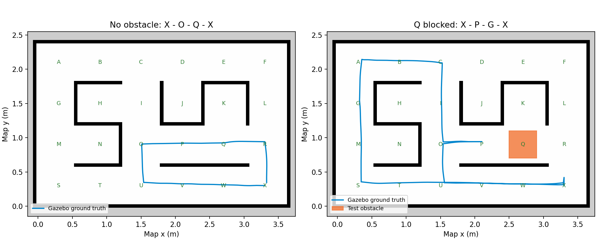

# Gazebo实测结果

最终代码两组独立测试均完成四个goal；无障碍场景没有误报障碍；Q障碍只确认一次并重新规划。

| 测试 | 完成goal | 车身与墙/障碍重叠帧 | 最大真实到点误差 |
|---|---:|---:|---:|
| final_clear | 4 | 0 | 5.43 cm |
| final_obstacle | 4 | 0 | 4.88 cm |

真实位置只由独立测量器读取，没有输入AMCL或控制。碰撞检查把20x20cm旋转车身与SDF墙体/障碍矩形做二维分离轴检测；不包括地面接触，也不是实机碰撞传感器。

5cm为AMCL估计坐标的goal复核容差，不是实际位置零误差保证。真实位置与AMCL的差异已按结果原样记录；未上机验证。轮距、摩擦和轮速映射仍需实机核对。

改动过程：首轮发现墙回波误识别；加入与地图墙面的明确排除带。之后完成无障碍全路线。到点初轮G真实偏差8.2cm，改为接近2.5cm再停车，等待新AMCL按5cm复核。随后完成有障碍全路线，再运行本报告两组最终回归。

源码校验值：

- navigation.py: c9c94f9a7b79edd6ecf69135c0ebc206c808dec0acd71580b05019ddbcd2f22c
- planning.py: 85b169098527ab49deb7322846160e8c22c20ff898fa1fd30ee88d50e1d0c6d3
- robot.launch.py: 7794a9266ba2c2e172c9d5b29d34fc18061f1f5a0228d86238050d4f2816fb8e

最终图形入口也已启动验证：Gazebo Ogre界面与RViz窗口均创建并持续运行，RViz报告OpenGL4.6。传感器服务器采用headless EGL，避免本机Ogre2 GUI驱动崩溃。测试进程已退出，无遗留运动任务。
