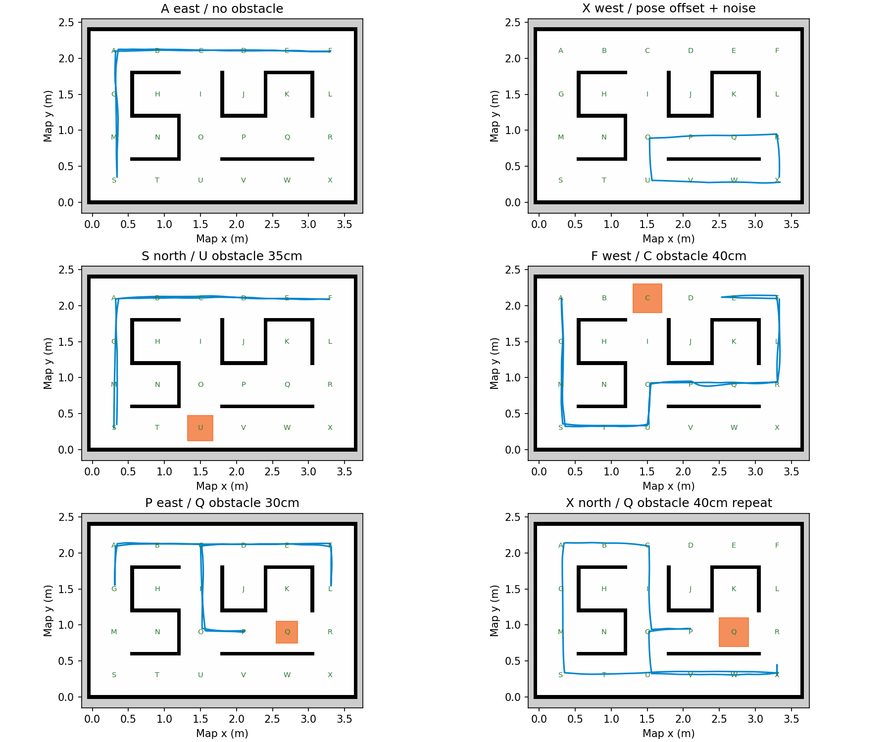

# 六组Gazebo回归结果

全部六组完成四个目标，24/24；车身与墙/障碍几何重叠检查为零；检测到的障碍字母与场景一致，无额外假障碍。导航代码和控制参数未因各组测试单独调整。

| 起点朝向 | 四个goal | 障碍 | 最大真实到点误差 | AMCL位置RMSE | AMCL朝向RMSE |
|---|---|---|---:|---:|---:|
| A / E | A,F,S,A | 无 | 6.55cm | 3.80cm | 0.99° |
| X / W | X,O,Q,X | 无；位置/角度偏差及噪声 | 6.25cm | 4.22cm | 1.38° |
| S / N | S,C,F,S | U，35cm | 6.55cm | 3.77cm | 1.11° |
| F / W | F,A,P,F | C，40cm | 5.11cm | 3.80cm | 1.05° |
| P / E | P,L,G,P | Q，30cm | 5.47cm | 3.36cm | 1.11° |
| X / N | X,P,G,X | Q，40cm | 5.08cm | 4.35cm | 1.39° |

按严格的真实位置5cm评价，18/24个goal达标，最大真实误差6.55cm。因此“任务完成”不等于“实际位置始终在5cm以内”。

### 测试链路真实性

Gazebo真实运行物理引擎、四轮差速模型和GPU雷达。/scan由模拟激光桥接，实际nav2_amcl节点接收；轮速/IMU进入真实robot_localization EKF节点，融合后的/odom与AMCL参与导航。当前AMCL沿用项目的自定义signed-vector运动模型插件，不是另写的假定位器。

每组都记录了ROS话题发布/订阅拓扑：/sim/ground_truth只有simulation_evidence测试记录器订阅；导航和EKF/AMCL没有订阅真实坐标。AMCL误差按消息时间匹配仿真真实位姿评估，匹配间隔不超过80ms。

噪声组：实际出生位置偏移(+4cm,-2cm)、朝向偏5°，仍以名义格中心和正方向初始化AMCL；雷达距离高斯标准差2cm，陀螺仪角速度高斯标准差0.02rad/s。其他组雷达噪声标准差5mm，IMU角速度不额外注入噪声。

### 障碍覆盖

C40cm组在运动过程中发现阻路障碍，退出原路线并长距离绕行；Q40cm组重复运动中发现障碍和重规划。Q30cm组在起点停车阶段已发现障碍，随后规划直接绕开。U35cm组发现障碍时它不在剩余路线，保持原路线完成；这一组用于检查不会见到旁边障碍就无谓改路。所有场景只放一个障碍，没有验证两个障碍同时存在或运行中移动障碍。

### 与实机的区别

地图墙体由同一张定位地图生成，几何匹配比真实场地理想。18cm轮距、轮胎摩擦、速度响应和40/35/30cm方块为模型假设，未按真实机器人标定。没有模拟串口固件错误、无线断连、电池变化、完整轮胎打滑和反射材料。陀螺仪噪声组不等于验证长期IMU漂移。仿真中的通过不能证明实机已经通过。

碰撞统计是20x20cm旋转车身与墙/障碍的二维几何重叠检查，不是硬件碰撞传感器或接触力检测。

复跑：`bash ~/rb3302_fresh/test_sim.sh`。每次结果会保存到新的带时间目录，不覆盖此批证据。

### 测试版本

- clean/navigation.py: c9c94f9a7b79edd6ecf69135c0ebc206c808dec0acd71580b05019ddbcd2f22c
- clean/planning.py: 85b169098527ab49deb7322846160e8c22c20ff898fa1fd30ee88d50e1d0c6d3
- clean/navigation.yaml: 629536a91a9639ba54a1b44911c27d2053458a6f8f2952545683049eba6189a1
